# GIS-first data lake

`epsm-db` is a small source lake and GIS publication pipeline. It targets a
**fresh PostgreSQL 15+ / PostGIS database**. The earlier modelling schema and its
`sweden-ubem` pipeline were retired on 29 October 2026 (archived under
`archive/2026-10-29/`); nothing migrates a legacy database in place.

## Model

Two schemas have distinct jobs:

- `lake`: source entities, source identifiers, file progress and evidence links.
- `gis`: ready-to-use domain layers, with numeric feature IDs, EPSG:3006 geometry
  types, spatial indexes and prepared attributes.

```mermaid
erDiagram
    SOURCE ||--o{ SOURCE_FILE : provides
    SOURCE_FILE o|--o{ BUILDING : registry_record
    SOURCE_FILE ||--o{ COMPONENT : geometry_record
    SOURCE_FILE ||--o{ PROPERTY_PART : polygon_record
    SOURCE_FILE ||--o{ ADDRESS : address_record
    SOURCE_FILE ||--o{ EPC_RECORD : certificate_record
    SOURCE_FILE ||--o{ HEIGHT : measurement_record
    SOURCE_FILE ||--o{ AREA : boundary_record
    SOURCE_FILE ||--o{ STATISTIC : observation_record
    SOURCE_FILE ||--o{ ROAD : nvdb_record

    BUILDING ||--|| MODEL_FACTS : summarized_at_publication
    EPC ||--|| MODEL_CERTIFICATE : scope_and_date_summary

    PROPERTY o|--o{ PROPERTY_PART : contains_when_source_reference_exists
    BUILDING ||--o{ COMPONENT : contains
    COMPONENT o|--o{ HEIGHT : resolves_source_reference
    BUILDING ||--o{ BUILDING_PROPERTY : has
    PROPERTY ||--o{ BUILDING_PROPERTY : links
    BUILDING ||--o{ BUILDING_ADDRESS : has
    ADDRESS o|--o{ BUILDING_ADDRESS : resolves
    EPC ||--o{ EPC_SUBJECT : describes
    EPC ||--o{ EPC_RECORD : preserves
    BUILDING ||--o{ BUILDING_EPC : has
    EPC_SUBJECT ||--o{ BUILDING_EPC : links
    AREA o|--o{ AREA : explicit_parent_reference
    AREA o|--o{ STATISTIC : matches_type_code_edition
    BUILDING ||--o{ BUILDING_AREA : located_in
    AREA ||--o{ BUILDING_AREA : contains_point

    BUILDING {
        bigint building_id PK
        text external_id UK
        geometry footprint_3006
    }
    COMPONENT {
        bigint component_id PK
        bigint building_id FK
        text external_id UK
        geometry polygon_3006
    }
    AREA {
        bigint area_id PK
        text area_type "country county municipality regso deso grid custom"
        text external_id "original area code with leading zeros"
        text boundary_version "geography edition"
        bigint parent_area_id FK
        geometry polygon_3006
    }
    STATISTIC {
        bigint observation_id PK
        bigint area_id FK "nullable until geography is available"
        text indicator
        text period "observation period"
        text unit
        json dimensions "sex age category"
        float value "nullable for missing or suppressed values"
        text value_status
    }
    BUILDING_AREA {
        bigint link_id PK
        bigint building_id FK
        bigint area_id FK
        text status "matched or ambiguous"
        text method "representative point"
    }
    ROAD {
        bigint road_id PK
        text external_id UK
        text source_layer
        text network_link_id "NVDB source network reference"
        float start_measure
        float end_measure
        geometry geometry_3006
        json attributes "original NVDB fields"
    }
    MODEL_FACTS {
        bigint fid PK "numeric building key"
        text building_type "derived classification"
        integer construction_year "reported registry year"
        bigint selected_epc_id "nullable when latest is unresolved"
        boolean single_building_epc
        text ventilation_system "reported or explicitly unresolved"
    }
    MODEL_CERTIFICATE {
        bigint fid PK "numeric certificate key"
        date certificate_date "nullable"
        text date_status "reviewed source mapping"
        bigint subject_count
        bigint loaded_building_count
        text matching_status
    }
```



Properties retain all part-level municipality/designation aliases for EPC matching,
with a representative designation for display. Properties can contain several polygon parts; buildings can have several
components, addresses, properties and certificates. Links retain these
relationships rather than multiplying rows in one universal table. Registry
buildings without geometry and unmatched evidence remain in `lake`.

Each entity gets a normal bigint database key. Original identifiers are attributes
with unique constraints; geometry is never hashed to create, validate or join a
key. Existing prepared component IDs can be ingested unchanged as **opaque source
references**, including any upstream hash suffix. Height evidence resolves those
references to numeric component keys once during linking. New direct GPKG imports
use source feature IDs. Imported component/part identities spanning different
files are rejected for explicit resolution rather than silently merged.

A snapshot uses one immutable version of each named source. Repeating its import
resumes/skips work. A new source release uses a new snapshot database; numeric
keys are stable within a snapshot, while original source identifiers connect
releases. This first implementation intentionally has no in-place release
replacement or automatic migration from schema 0.0.4.

## Workflow

Install the checkout with `python -m pip install -e .`. Create an empty database
owned by the ingestion administrator and set `EPSM_DATABASE_URL`. Keep credentials
in `.pgpass` or another local credential mechanism. `UBEM_DATABASE_URL` is also
accepted for compatibility. SQL initialization requires permission to install
PostGIS, or PostGIS can be installed beforehand by the database administrator.

```bash
export EPSM_DATABASE_URL='postgresql://ubem_owner@127.0.0.1:55433/epsm_gis'
epsm-db init
# Publish geometry and height evidence first, independently of EPC matching.
epsm-db ingest config/gis-lake.toml --source-root /path/to/source-bundle \
  --kinds components heights
epsm-db link
epsm-db publish
# Add the other source domains when available, then update links and snapshots.
epsm-db ingest config/gis-lake.toml --source-root /path/to/source-bundle \
  --kinds buildings addresses properties epc
epsm-db link
epsm-db publish
epsm-db status
```

`epsm-db run config/gis-lake.toml --source-root /path/to/source-bundle` combines
initialization, import, linking and publication. `--kinds` applies to `run` too.
There is no municipal acceptance gate before national source geometry is usable.
A single snapshot contains national entities; municipality/bounding-box filters
select subsets without copying them into separate dataset cohorts.

Source import commits batches of at most 4,096 rows / 32 MiB estimated serialized
size by default. `--batch-rows` and `--batch-bytes` control these bounds. COPY
loads a temporary staging table; set-based inserts resolve numeric foreign keys.
The checkpoint and source writes commit together. A session lock allows one
writer at a time while import batches commit independently. Readers can continue
using the last published snapshots.

A file checkpoint stores path, size, modification time, row position and state.
Changing an already checkpointed file is rejected. Sources must remain immutable;
size/mtime checks are operational checks, not content verification.
`--file-checksums` optionally verifies a checksum per file. No geometry/record
checksums, immutable policy DAG, record-hash registry or per-municipality copy is
created. Large JSON input should use JSONL; JSON arrays are read as one document.
EPC records and unmapped attributes remain available as JSONB/source files.

Each command reports structured progress on stderr and a JSON result on stdout.
`status` shows completed/failed imports, source revision, linked revision and GIS
publication time. `gis.publication_status` and `gis.sources` expose publication
freshness and incomplete source files to readers. Partial source availability
is visible explicitly; publication does not claim scientific acceptance.

## Boundaries, statistics and roads

These domains share the same database and source-file provenance as the building
evidence. A separate physical PostgreSQL database is unnecessary for their joins.

`lake.area` stores country, county, municipality, RegSO, DeSO, SCB population-grid
and custom boundary types. The identity is **type + original area code + boundary
edition**. Explicit parent references can express administrative/statistical
hierarchies; grids and other overlapping geographies do not need a parent.
The country/municipality/RegSO/DeSO layers are views of one geography model.

`lake.statistic` stores indicator, observation period, unit, categorical dimensions,
raw value and availability status. The observation year and boundary edition are
separate: 2024 observations can explicitly refer to the 2025 boundary edition.
Missing or nonnumeric source values remain NULL with their original marker; they
are never zero-filled. No source revision is silently joined to another geography
edition. Unresolved area references remain available as evidence.

`lake.building_area` links each building's stored representative point to all
applicable area types/editions. Border ties remain ambiguous. Statistical values
are **area context**, not household/building-level measurements or allocated
population/income estimates.

NVDB ZIP archives are streamed into temporary GeoPackage files, then their layers
are read in deterministic order with source FIDs, layer names and member names
preserved. The original `RLID` is a network reference: thematic features and events
can share it, so it is not assumed to be a unique feature key. Line, point, polygon
and nonspatial records remain in `lake.road`; original NVDB attributes remain JSONB.
The importer needs temporary disk space for the uncompressed GeoPackages. The
archives remain the source files used for checkpoints and provenance.

Additional GIS interfaces:

| Name | Contents |
|---|---|
| `gis.boundaries` | Indexed polygons for every area type and boundary edition |
| `gis.statistics` | Statistical observations with period, unit, dimensions and status |
| `gis.area_statistics` | Statistics joined to the exact boundary edition; filter indicator/period before mapping |
| `gis.building_areas` | Building memberships and their match status |
| `gis.building_statistics` | Area context reached through unambiguous building memberships |
| `gis.roads` | Indexed NVDB line features with network references and original attributes |
| `gis.road_points`, `gis.road_areas` | NVDB point assets and polygon features |
| `gis.road_attributes`, `gis.context_records` | Original attributes and source-file/record references |

Boundary polygons are stored once per published boundary feature. The general
statistics map view joins indexed area IDs and geometry; it does not duplicate
geometry for every indicator/year/category. Add indicator/period/dimension
filters before mapping it. Ordinary `gis.boundaries` and road browsing use the
prepared spatially indexed snapshots.

`config/gis-context.toml` declares the Mac-provided DeSO 2025 GeoPackage and NVDB
GeoPackage ZIP exports. See [Mac source transfer](mac_gis_sources.md) for the exact
staging paths/commands. Other national boundaries and SCB statistics need their
source files and explicit manifests; the schema supports them but does not claim
those inputs are already supplied. `config/gis-statistics.example.toml` shows
normalized long-form statistics and a wide population-grid import. A wide grid
source can load its polygons and selected indicators in the same file pass.

SCB revises statistical geography; see [DeSO editions](https://www.scb.se/hitta-statistik/regional-statistik-och-kartor/regionala-indelningar/demografiska-statistikomraden-deso)
and [published population-grid statistics](https://www.scb.se/vara-tjanster/oppna-data/oppna-geodata/statistik-pa-rutor/).

## Source adapters

`config/gis-lake.toml` describes the existing portable national bundle. Only
selected `--kinds` need to exist for an incremental import. Paths are relative to
`root`; `--source-root` relocates them without changing source identities.

| Kind | Supported source inputs | Identity / normalization |
|---|---|---|
| components | Prepared component Parquet, LM GPKG or normalized JSONL | building UUID/source ID plus original component/feature ID |
| buildings | LM Byggnad XML or normalized Parquet/JSONL | building source ID; highest object version/date wins |
| properties | LM property GPKG or normalized Parquet/JSONL | property unit ID plus polygon-part ID |
| addresses | LM address XML, vector files or normalized records | address ID; XML axis order handled by the existing parser |
| heights | Height catalogue Parquet or normalized JSONL | component source reference; all evidence records retained |
| epc | Boverket pipe-delimited exports or normalized records | original certificate/regime, subjects and raw export rows |
| areas | GPKG/GeoJSON/Parquet polygons | area type, source code and boundary edition |
| statistics | Normalized long-form CSV/Parquet/JSONL, or configured wide indicators | area edition, indicator, period, unit and categorical dimensions |
| roads | GPKG, GeoPackage ZIP exports and normalized vector/Parquet records | source feature identity, layer/member and NVDB network reference |

Vector sources and GeoParquet with declared CRS must use EPSG:3006. Raw Parquet
without CRS metadata and normalized JSONL use the manifest's explicit `srid=3006`
contract. Polygon/MultiPolygon geometry is stored once in normalized 2D form;
non-polygon components are rejected with a file/record error. Invalid polygons
are retained with a validity flag and excluded from automatic spatial matching.
Original files remain the full-fidelity source archive.

Column mappings can be supplied per source, for example:

```toml
schema_version = 1
root = "/path/to/sources"
srid = 3006

[[sources]]
name = "lm-direct-components"
version = "2026-10"
kind = "components"
path = "buildings.gpkg"
layer = "byggnad"
[sources.columns]
building_external_id = "objektidentitet"
```

Without a component ID column the direct adapter uses source name, relative file
path and original FID. **Existing prepared heights must reference those same
component IDs.** Direct GPKG features are not silently equated with the old
hash-derived components. Use the prepared component source with its existing
height catalogue, or prepare an explicit source-ID crosswalk before switching
those sources. There is no geometry-hash matching fallback.

Height evidence paths remain source references. This pipeline does not open,
copy or reverify tens of thousands of measurement files simply to display their
catalogued values. Keep the original measurement archive alongside the catalogue.
Source quality/status fields remain evidence, including staging-only metadata;
GIS publication does not promote staging evidence to validated measurements.

## Linking rules

- Components resolve their owning building during import.
- Registry entrance references resolve addresses by original address ID.
- Heights resolve components by original source reference.
- Component and property-part unions are calculated once after source import and
  stored with spatial indexes. Dirty geometry is recomputed only when needed.
- Building/property intersection uses the stored indexed polygons in one set
  operation. All positive overlaps are retained. Exactly one property above the
  threshold is marked matched; multiple qualifying properties are ambiguous.
  The default threshold is 0.5; `link --minimum-overlap` accepts 0.5–1.
- EPC subjects use an explicit building reference when present. Otherwise a
  matched property, municipality and exact registered house number generate
  candidates. One candidate is matched; multiple candidates remain ambiguous.
  Subjects without sufficient identifiers remain unlinked evidence.
- Original EPC records are retained, including optional field parse issues.
  Certificate summaries take the last available normalized value in deterministic
  file/row order. Unmapped values and conflicting source records stay inspectable.

Property matching is skipped for height-only/metadata updates. EPC linking is
skipped when none of its inputs changed. Linking does not run spatial queries
inside a certificate loop. Link IDs are preserved for relationships that survive
rebuilding. The default rules are deliberately explicit and do not reproduce all
historical modelling/acceptance policies or infer demolition/site chronology.

## GIS layers and access

| Name | Contents |
|---|---|
| `gis.buildings` / `gis.footprints` | One footprint per building, registry fields, counts and component height range |
| `gis.component_heights` / `gis.components` | Component polygons with latest height evidence and status |
| `gis.properties` | Property-unit polygons and designations |
| `gis.addresses` | Address points |
| `gis.building_properties` | Building polygons with property links, overlap and status |
| `gis.epc_links` | Building polygons with linked certificate fields, method and status |
| `gis.building_addresses` | Original building/address reference links, including unresolved references |
| `gis.epc_records`, `gis.height_evidence` | Original record attributes and all height evidence |
| `gis.source_records`, `gis.sources` | Source entity attributes, file/row references and versions |
| `gis.property_aliases` | All property-part designation/municipality references used for EPC matching |

The building/evidence map snapshots have a unique numeric first column, concrete geometry type,
EPSG:3006 and GiST spatial indexes. Simple aliases reuse those snapshots without
copying geometry again. Map requests read indexed geometry and prepared columns;
normalization, height selection and evidence joins run at publication time.
Refreshes use PostgreSQL's concurrent materialized-view refresh inside one
transaction, so clients can read the previous published state until commit.
Refresh runtime and storage overhead still need measurement on real workloads.

The component layer selects the newest dated height record, falling back to
import order for undated evidence. Missing/undetermined heights stay NULL with
status fields; they are never zero-filled. Building summaries expose minimum and
maximum component heights rather than inventing one building height. Certificate
Atemp values remain certificate totals, repeated on links for inspection; summing
those values over linked buildings can double-count a shared certificate.

Grant an existing participant/group access:

```bash
epsm-db grant ubem_readonly
```

The role receives SELECT on `gis`, with no source-table ownership or ingestion
privileges. Database roles are cluster-wide; existing participant credentials can
be reused on a second database by granting their group there. For a new database
on this laptop's PostgreSQL instance, use the existing private Tailscale host and
port, selecting the new database name in QGIS. The source onboarding service can
remain on its configured database while access to this snapshot is granted
separately. Moving onboarding's default database is a separate cutover.

```python
from epsm_db import Lake
lake = Lake()  # reads EPSM_DATABASE_URL
features = lake.features('component_heights', municipality_code='1485', limit=1000)
# Each row includes geometry as WKB in EPSG:3006, plus prepared attributes.
```

Full SQL access to `gis` supports property/building/component/address/EPC/evidence
joins through the numeric IDs. Vector tiles can later read these prepared layers;
the branch does not introduce another serving stack.

## Branch implementation status

The replacement schema, import adapters, CLI, link rules, GIS publication,
reader API and GeoPackage extracts are implemented. The separate `epsm_lake`
candidate is ingesting national sources while the old ingestion service is paused.
DeSO is published; operational checks covered registered-reader Python access,
QGIS geometry discovery and an actual area extract. Full national ingestion,
acceptance, performance measurements and the main-database switch remain pending.
No unit-test suite was added or run during this setup.

## Client access and extracts

The [access guide](gis_lake_access.md) describes the deployed candidate database,
registered-reader access and streaming municipality/area/bbox GeoPackage extracts.

## Cadastral parts without property references

The national property source includes 118,442 polygon features without a
`registerenhetsreferens`, mostly unresolved property/common-land areas. Each has
a stable source `objektidentitet`. These remain in `lake.property_part` with
`property_id = NULL` and are exposed as `gis.property_parts`, labelled
`missing_source_reference`. Their original geometry, object type, designation
and provenance are retained. They do not create synthetic property units or
participate in property/EPC matching until an actual source reference is available.
Registered property units remain in `gis.properties`.

## Stock and EPSM models

The [stock API](stock_api.md) restores Database, Stock, StockCell and BuildingRecord
over this lake. Its workflow diagram distinguishes geographic footprint components
from Data construction assemblies and shows explicit archetype application.
