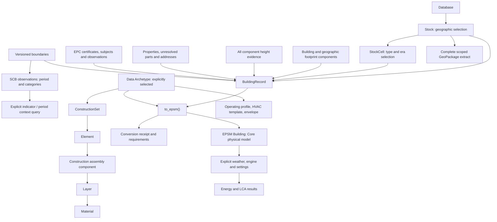

# Stock workflow over the GIS lake

Version 0.4.0 makes `epsm_db.Database`, `Stock`, `StockCell`, `BuildingRecord`,
`Receipt` and `BuildingType` the canonical Python API for lake schema version 2.
`Lake` and `epsm-db` own administration; QGIS continues to use the indexed `gis`
map layers. Python queries use direct PostgreSQL connections with registered
reader credentials. No HTTP service is needed.

## Connect and explore

```python
from epsm_db import Database

# Use a PostgreSQL service/password file or construct a connection string locally.
db = Database("service=epsm_lake")
stock = db.stock(municipality="1485")   # "Uddevalla" is also accepted
print(len(stock))
print(stock.matrix())
cell = stock.cell(building_type="multi_family", era="SE.02")
```

Constructors and representations do no database I/O. `Stock` loads no catalogue
until a catalogue operation is requested. Install `epsm_db[catalogue]` for matrices
and cells (Data 0.6.0+), and `epsm_db[epsm]` for conversion (EPSM 0.3.0+ and Core
0.4.0+). These coordinated private packages must be available locally or through
your configured package source.

Geographic filters intersect. Coordinates are EPSG:3006 metres. Bounding boxes
and selected boundaries use exact geometric intersection, keeping whole features.
Municipality filters use registry codes. A boundary selection must resolve to
one edition; an omitted edition is accepted only when there is one candidate.

```python
rectangle = db.stock(bbox=(315000, 6470000, 325000, 6480000))
area = db.stock(area_type="deso", area_code="0114A0010", boundary_version="2025")
record = stock.record("source-building-uuid")
handle = db.building(record.building_id)
print(handle.components())
print(handle.heights())
print(handle.properties())
print(handle.property_parts())
print(handle.addresses())
print(handle.epc_certificates())
print(handle.areas())
```

`record.building_id` is the source identifier. `record.facts["internal_id"]` is
the numeric database key; it is not a portable cross-database identity. Receipts
identify the database and source/publication revision. Geographic footprint
components retain their own IDs and all associated height observations. Unresolved
cadastral parts intersecting the footprint are explicitly labelled spatial
candidates; their legal property reference remains missing.

## Previews and complete selections

```python
frame = cell.frame()               # Up to 1,000 buildings, including null geometry
print(frame.attrs["receipt"])
components = cell.component_frame(limit=1000)

# Continue a truncated preview without OFFSET paging.
receipt = frame.attrs["receipt"]
if receipt.truncated:
    next_page = cell.frame(after=receipt.next_cursor)

for record in cell.iter_records(batch_size=100):
    print(record.building_id, record.atemp_m2)
```

Frames are GeoDataFrames in EPSG:3006. Limits count output rows; a component
preview limit counts components. Truncation emits a warning and sets the receipt's
`truncated` and `next_cursor`. Cursor paging is stable within a publication;
compare receipt revisions if a new publication occurs between preview requests.

Iteration uses numeric keysets and bounded hydration batches within one read-only,
repeatable-read transaction. It performs a fixed set of relation queries per
batch, rather than queries per building. Exhaust or close iterators promptly so
the snapshot and database connection are released. `records()` and `to_epsm()`
explicitly materialize all results; use their iterator counterparts nationally.

Counts and matrices use SQL aggregation. All classifications and missing-year
buildings remain represented; a missing footprint or EPC does not remove a
registry building from its stock.

## Explicit physical conversion

```python
# Source evidence only; missing modelling inputs remain unresolved.
buildings, receipts = cell.to_epsm()

# Explicit representative type/era constructions and supported definitions.
buildings, receipts = cell.to_epsm(
    archetype="cell",
    calendar={"calendar_year": 2023},
    storeys=3,              # Illustrative caller assumption, not source evidence
    storey_height_m=2.8,    # Illustrative caller assumption; replace for your study
)

# A predefined or custom Data Archetype uses the same route.
from epsm_data import Catalogue
selected = Catalogue.load().get("mf_se02", state="existing")
building = record.to_epsm(archetype=selected, storeys=3, storey_height_m=2.8,
                          calendar={"calendar_year": 2023})

for building_or_none, receipt in cell.iter_epsm(archetype="cell"):
    print(receipt.building_id, receipt.identities["conversion_status"])
```

Conversion delegates to `epsm.Building.from_record`. `archetype="cell"` chooses
the unique canonical type/era definition, using a declared renovation state or
the catalogue's `existing` representative state. This is not evidence of a
building's renovation history. SE.07 has no renovation state. Unsupported or
ambiguous catalogue selections raise explicitly. Declared climate context and observed ventilation
filters do not choose installed systems. Climate zone is catalogue context, not an
inferred geographic climate classification. `cell.archetype_slot` remains an explicit
advanced scalar-inspection route requiring a climate zone and ventilation code.

Missing inputs yield draft Buildings. Invalid inputs yield no Building and a
failure receipt. Collection conversion returns every receipt in source order;
models retain their source identifiers. `iter_epsm()` keeps each outcome paired.
Receipt `fields["model_readiness"]` lists physical requirements. Conversion does
not claim engine/weather validation or run simulations, so
`ready_for_simulation` remains false. EPSM retains the full archetype application
reports and the portable source record in the resulting Building.

The current EPSM adapter requires usable footprint, storeys and storey height to
create physical geometry. Height evidence is retained independently; this API
never rounds LiDAR height into storeys, flattens differing component heights or
rescales a footprint to reported Atemp. Unsupported geometry and missing systems,
reference areas, calendars or site conditions remain explicit requirements.
Weather and engine choices belong to a subsequent `building.simulate(...)` call.

Records keep raw EPC values, mapping authority and ambiguous links. Unknown or
conflicting certificate dates and latest-date ties prevent selecting one latest
certificate. Shared certificates retain their totals without building allocation.
Reported Atemp and geometric conditioned floor area keep their different meanings.
`epc_heating()` reports exclusions; it does not allocate a shared heating total.

Portable exchange retains `epsm-record-1` and EPSG:3006. New readers accept older
envelopes lacking area/property-part additions. New records require this updated
DB reader; compatibility with older decoders is not claimed. Database credentials
and private runtime fields are excluded. Inspection and serialization perform no
network or database access.

## Extracts and context

```python
cell.extract("selected-buildings.gpkg")
stock.extract("buildings-and-parts.gpkg", layers=["buildings", "property_parts"])

# Geographic context bundles retain the existing GIS extractor.
db.extract("municipality.gpkg", municipality_code="1485")

observations = handle.context(indicator="population", period="2025",
                              dimensions={"sex": "total"})
```

Stock extracts select the same building IDs as iteration and counts, including
buildings with null footprints. Default layers are buildings, components with
latest heights, linked properties, linked addresses and EPC links. Related entities
are retained whole across selection boundaries. Explicit `property_parts` includes
unresolved spatial candidates. Optional roads/statistical context layers use the
stock's geographic selection and require one. GeoPackages retain source keys in `fid` and use a separate numeric `gpkg_fid`
primary key for reliable batch appends. Every extract streams batches,
refuses existing output files and records the selection/publication in a metadata
sidecar. No preview limit applies.

Statistics require an explicit indicator and period; optional dimensions narrow
categories. Returned observations retain area/edition/period and are labelled
`area_context`, not building measurements. See [GIS access](gis_lake_access.md)
for direct SQL, QGIS and road/boundary layers.

## Publication and migration

A model read requires matching source, linked, GIS and model revisions in its
transaction snapshot. Otherwise `PublicationPendingError` explains the pending
publication. QGIS and `db.features()` can still read the existing published map
layers. A coherent partial publication remains readable, with incomplete-source
coverage retained in record receipts.

For an existing version-1 GIS lake, after the national build completes:

```bash
epsm-db migrate
epsm-db publish
```

The migration adds reader views, a reviewed field-mapping registry and compact
model summaries. It reuses source rows and preserves reader grants; there is no
source reingestion. Migration and publication use the existing writer lock.
Initialize fresh databases with `epsm-db init`; PostGIS must already be installed
by an administrator when the database owner is not a superuser.

The Python exports target the GIS lake. The historical `sweden-ubem` SQL operations
are retired and archived under `archive/2026-10-29/`; no release migrates a legacy
database or promotes/deletes any database. Roll back application code only alongside the matching schema;
retain the previous deployed runtime until the new publication is validated.

## Model and package responsibilities

The lake relationships are in [the lake model](gis_first_lake.md#model). The
workflow below is maintained in `diagrams/09-stock-epsm-workflow.mmd`.

A **geographic footprint component** is an observed polygon belonging to a
building. A **construction assembly component** is part of Data's material
hierarchy. They have separate identities and meanings. Data defines physical
recipes; Core owns geometry and physical validation; EPSM applies recipes and
runs evaluations; DB owns evidence and selection.


